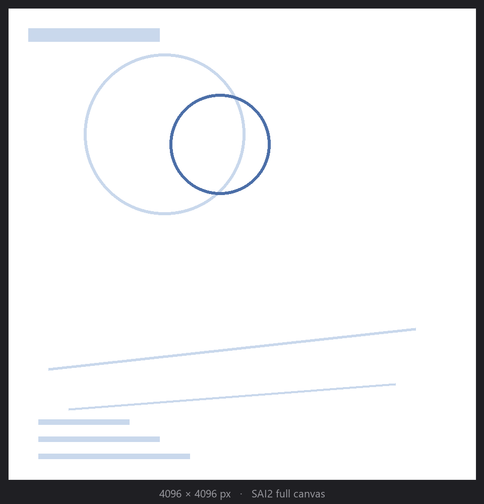

# QuickLook.Plugin.SaiViewer

A [QuickLook](https://github.com/QL-Win/QuickLook) plugin that previews
**PaintTool SAI Ver.2 (`.sai2`)** files by pressing <kbd>Space</kbd> — at **full
canvas resolution**, not the tiny 256 px thumbnail SAI stores for explorers.



*Panel layout mockup — abstract shapes only, no canvas artwork is included in
this repository.*

SAI2 files carry two preview payloads: `thum` (a lossy jssf/JPEG thumbnail,
usually 256 px) and `intg` (a 1:1 lossless copy of the composited canvas,
dpcm-compressed). This plugin decodes `intg`, so the preview stays sharp when
the window is enlarged, and falls back to `thum` when a file has no `intg` block.

## Requirements

- Windows 10 / 11
- QuickLook 4.x (includes the Microsoft Store 4.5.0 build)
- .NET Framework 4.6.2+ (already present on Windows 10/11)

## Install

**Download:**
[QuickLook.Plugin.SaiViewer.qlplugin](https://github.com/SAKURA862/QuickLook.Plugin.SaiViewer/releases/latest/download/QuickLook.Plugin.SaiViewer.qlplugin)
([all releases](../../releases))

**Option 1 — `.qlplugin`**

Grab `QuickLook.Plugin.SaiViewer.qlplugin` from [Releases](../../releases), select
it in Explorer, press <kbd>Space</kbd>, click **Install** in the panel, then
restart QuickLook.

**Option 2 — manual**

Copy `QuickLook.Plugin.SaiViewer.dll` into any folder under QuickLook's plugin
directory (subfolders are scanned recursively), then restart QuickLook:

```
%APPDATA%\pooi.moe\QuickLook\QuickLook.Plugin\
```

The Microsoft Store build of QuickLook redirects that path to:

```
%LOCALAPPDATA%\Packages\21090PaddyXu.QuickLook_<hash>\LocalCache\Roaming\pooi.moe\QuickLook\QuickLook.Plugin\
```

QuickLook locks the DLL while running — quit it from the tray icon before
copying, otherwise the copy fails with "used by another process".

**Option 3 — build it yourself**

```powershell
git clone https://github.com/SAKURA862/QuickLook.Plugin.SaiViewer
cd QuickLook.Plugin.SaiViewer
dotnet build src/QuickLook.Plugin.SaiViewer.csproj -c Release
```

Then pack it (see `scripts/pack.ps1`) or copy `src/bin/Release/QuickLook.Plugin.SaiViewer.dll`
into the plugin folder above.

## Usage notes

- **Read-only.** Files are opened with `FileShare.ReadWrite | FileShare.Delete`;
  the plugin never calls a write, rename or delete API, so a preview can never
  alter or damage a canvas — and it can preview a file that SAI currently has
  open.
- The decode resolution follows the panel size (≈1.3× the displayed long side,
  clamped to 768–2048 px); larger canvases are boxed down by an integer factor
  while decoding, which keeps memory sane without visible loss at preview size.
- Decoding is parallelised per 256×256 tile. Measured on an 8-core machine:
  4096×4096 ≈ 0.37 s, 2480×4214 ≈ 0.11 s, average over 291 real files ≈ 0.15 s.
- Transparent canvases are drawn over a checkerboard.
- The panel opens at up to 92 % of the screen's work area — a 4096×4096 canvas
  gets roughly the same sized window as previewing a 4096×4096 PNG — while small
  canvases open at their own size (at most 2.5× upscaled). The window can be
  resized.

## Limitations

- **`.sai` (PaintTool SAI Ver.1) is not supported, on purpose.** That is a
  different container: 4096-byte blocks with a block table, XOR-obfuscated with a
  static key, wrapping a virtual file system. Decoding it means undoing that
  obfuscation, which is not something this project wants to do (see *Legal* at
  the bottom). Only `.sai2` is handled — its blobs are plain, uncompressed
  containers of a documented compression format.
- No per-layer compositing or layer listing — the plugin shows the composite SAI
  itself wrote into `intg`.
- No decoding cache: re-previewing the same large file re-decodes it.

## How it works

1. The `.sai2` header starts with `SAI-CANVAS-TYPE0`; canvas width is at offset
   20, height at 24, entry-table count at 32, and the table starts at 64. Each
   entry is 16 bytes: 4-byte type tag, `u32` layer id, `u64` blob offset. A blob
   runs to the next entry's offset (the last one to EOF).
2. `intg` blob: tag `dpcm`, then one `u32` byte-size per 256×256 tile. Each tile
   starts with a `u16` checksum whose high byte is the tile column index. Every
   row is decoded channel by channel from a bit stream (prefix zeros + prefix
   `1`, a sign bit, `op` magnitude bits; opcode `0xF` emits a run of zeroes), then
   inverse-delta transformed horizontally and predicted from the row above. The
   channel count is `((header[17] & 7) == 0) ? 4 : 3`.
3. `thum` blob (fallback): 18-byte header (`u32` width, `u32` height, `jssf`,
   three `u16`) followed by a headerless baseline JPEG entropy stream. The plugin
   rebuilds DQT/DHT/SOF0/DRI/SOS segments and the per-MCU-row length prefixes plus
   `RSTn` markers into a decodable JPEG.

Format knowledge comes from [Wunkolo/libsai](https://github.com/Wunkolo/libsai) (MIT).

## Development

- `src/` — the plugin (7 files, ~1100 lines).
- `tools/Harness` — renders the panel to PNG off-line for every file in a folder;
  compile it together with `src/*.cs` (it uses the plugin's internal types).
- `tools/Compare` — decodes a file with both the scaled/parallel path and the
  straight reference path and reports byte differences.
- `scripts/pack.ps1` — builds a `.qlplugin` (zip with `QuickLook.Plugin.Metadata.config`
  at the root).

## 中文说明

- 用途：QuickLook 空格预览 PaintTool SAI Ver.2 的 `.sai2` 文件，显示**整幅画布
  1:1 的无损预览**（文件里的 `intg` 块），没有 `intg` 时退回 `thum` 缩略图。
- 安装：用 QuickLook 选中 `QuickLook.Plugin.SaiViewer.qlplugin` 按空格 → Install →
  重启 QuickLook；或把 DLL 放进 `%APPDATA%\pooi.moe\QuickLook\QuickLook.Plugin\`
  （商店版路径会被重定向到 `%LOCALAPPDATA%\Packages\...` 下）。
- 只读：只以读取方式打开文件，不调用任何写/改名/删除接口；SAI 正打开着该文件也能预览。
- 只支持 `.sai2`。`.sai`（Ver.1）是另一套「4096 字节块 + 静态密钥异或混淆」的容器，
  解开它等于破解混淆层，本项目有意不做（详见下方 Legal）。
- 大画布首次预览约 0.1–0.4 秒（按 256×256 瓦片并行解码）。
- 窗口默认开到屏幕工作区的 92%（4096×4096 的画布和直接预览同尺寸 PNG 差不多大），
  小画布按原尺寸显示、最多放大 2.5 倍，窗口可自由缩放。
- 与 SYSTEMAX Software Development 无任何关联，未使用其代码；格式知识来自 MIT 授权的
  libsai 与本机实测。

## Legal

- **Not affiliated with SYSTEMAX Software Development.** "PaintTool SAI" and
  "SAI2" are used descriptively to say which files this plugin can open. No
  SYSTEMAX asset (icon, logo, binary, documentation) is included or
  redistributed by this repository.
- **No SAI code was used or decompiled.** The format knowledge here was obtained
  from the publicly available MIT-licensed
  [Wunkolo/libsai](https://github.com/Wunkolo/libsai) write-up and reference
  implementation, and from inspecting files produced on the author's own
  machine. File layout facts (offsets, magic strings, tag names) are facts, not
  protected expression; the C# code in `src/` is written for this project.
- **No protection is circumvented.** `.sai2` blobs are not encrypted or
  DRM-protected; this plugin merely decompresses them. Support for the older
  `.sai` container, which *is* obfuscated, is deliberately out of scope (see
  *Limitations*).
- **Read-only by construction.** The plugin opens documents for reading only and
  never writes to, renames or deletes user files. Artwork stays on the local
  machine: nothing is uploaded, collected or logged to disk except an optional
  diagnostic log in `%TEMP%`.
- **Licensing of this repository:** MIT, with the notices for libsai, SaiThumbs
  and QuickLook.Common reproduced in [LICENSE](LICENSE).

## License

MIT — see [LICENSE](LICENSE), which also carries the notices for
[libsai](https://github.com/Wunkolo/libsai) and
[QuickLook](https://github.com/QL-Win/QuickLook).
